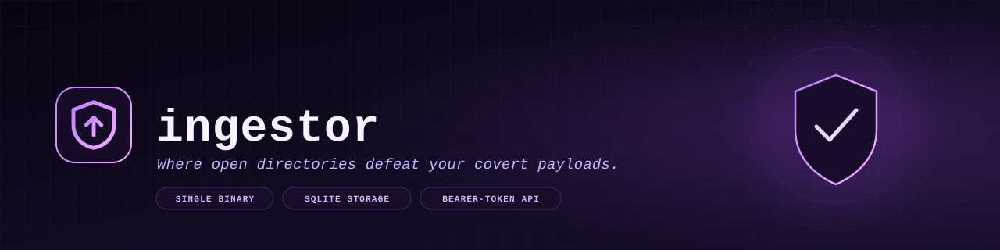

<p align="center">
  
</p>

<p align="center">
  <a href="https://github.com/its0din-ai/ingestor/releases/latest"></a>
  <a href="https://github.com/its0din-ai/ingestor/blob/main/go.mod"></a>
  <a href="https://github.com/its0din-ai/ingestor/pkgs/container/ingestor"></a>
  
</p>

**ingestor** is a self-hosted file ingestion server for airgapped environments and offensive engagements. It ships as a single Go binary with an embedded dashboard, a bearer-token upload API, quarantine rules, public share links, audit logging, and optional multi-user accounts. State lives in SQLite and a local upload directory - no external services and no CGO.

## Why this project was built

1. **Replace risky open directories.** Advanced persistent threats (APTs) often host payloads in open directories. Those directories are uncontrolled and easy to expose or lose; ingestor provides a dedicated ingestion server for payload delivery.
2. **Know what actually happened.** Without delivery telemetry, operators cannot tell whether a payload was delivered, blocked by the blue team, or never delivered at all. The upload response and audit log make each outcome visible.
3. **Exfiltrate simply and securely.** ingestor makes file exfiltration convenient and protects it with bearer-token authentication instead of brittle ad hoc tooling.

## Features

- Single static binary with an embedded web dashboard
- Bearer-token upload API for `curl` and other HTTP clients
- Multipart and raw-body uploads with collision-safe storage
- Extension-based quarantine with release support
- File browser with search, text preview, in-place editing, rename, download, and delete
- Public share links that require no authentication
- Audit log for logins, uploads, reads, downloads, settings, shares, and file actions
- Multi-user accounts with isolated storage, quotas, and per-user API tokens
- Hot-reloadable runtime settings and legacy `.env` compatibility
- Disk usage monitoring and reverse-proxy header support

## Quick start

Requirements: Go 1.26.6 or newer. CGO is not required.

```sh
cp .env.example .env
# set admin_password and a jwt_secret of at least 64 bytes:
# openssl rand -hex 64
go build -o ingestor .
./ingestor
```

Open `http://127.0.0.1:8080/login` and sign in.

To build, deploy, and supervise the process in the background:

```sh
./deploy.sh
```

## Docker

Prebuilt multi-arch images are published to GHCR:

```text
ghcr.io/its0din-ai/ingestor:latest
ghcr.io/its0din-ai/ingestor:3.13.1
ghcr.io/its0din-ai/ingestor:3.13
```

Create `.env` first, then start the stack:

```sh
cp .env.example .env
docker compose up -d
```

Data is stored in the `ingestor-data` and `ingestor-uploads` volumes and survives `docker compose down`. To pin a release or change the port:

```sh
INGESTOR_IMAGE=ghcr.io/its0din-ai/ingestor:3.13.1 \
INGESTOR_PORT=8080 docker compose up -d
```

To use host bind mounts instead:

```sh
mkdir -p ./data ./uploads
INGESTOR_DATA_DIR=./data INGESTOR_UPLOADS_DIR=./uploads docker compose up -d
```

On Linux, the container runs as UID/GID `10001`; make host directories writable by that user with `sudo chown -R 10001:10001 ./data ./uploads`.

## Configuration

All settings are read from `.env` (or the process environment, which takes precedence). Runtime settings such as `upload_dir`, `max_upload_mb`, and `quarantine_extensions` are seeded into SQLite on first boot and can be changed from the dashboard.

| Key | Default | Description |
| --- | --- | --- |
| `host` | `127.0.0.1` | Listen address |
| `port` | `8080` | Listen port |
| `db_path` | `data/ingestor.db` | SQLite database path |
| `admin_username` | `admin` | Superadmin username |
| `admin_password` | none | Seeds the superadmin on first boot |
| `jwt_secret` | none | HS512 session signing key, at least 64 bytes |
| `session_ttl` | `24h` | Dashboard session lifetime |
| `cookie_secure` | `false` | Mark the session cookie Secure (HTTPS) |
| `trust_proxy_headers` | `false` | Trust client IP and base URL headers from a reverse proxy |
| `upload_dir` | `uploads` | Upload root; new values must stay inside `uploads/` |
| `max_upload_mb` | `2048` | Maximum size of one upload |
| `write_timeout` | `2h` | HTTP write and body read deadline; `0` disables it |
| `audit_retention` | `30d` | Audit log retention; `0` keeps all rows |
| `bearer_tokens` | empty | Comma-separated `[label=]token[|RFC3339]` upload tokens |
| `SINGLE_USER` | `false` | Disable multi-user accounts for legacy deployments |

See [`.env.example`](.env.example) for the full reference.

## Upload API

Uploads require a bearer token:

```text
Authorization: Bearer TOKEN
```

Send one file per request to `POST /upload`, or to any non-GET method on `/`.

```sh
# multipart
curl -H "Authorization: Bearer $TOKEN" \
  -F "file=@report.txt" \
  http://127.0.0.1:8080/upload

# raw body
curl -H "Authorization: Bearer $TOKEN" \
  --data-binary @report.txt \
  "http://127.0.0.1:8080/?name=report.txt"
```

A non-empty `name` query parameter sets the exact stored filename; an existing file returns `409` and is never overwritten. Otherwise the multipart filename or `Content-Disposition` header is used, and API uploads receive a random suffix so concurrent uploads cannot collide.

```json
{
  "status": "ok",
  "message": "File received",
  "size": 13,
  "quarantined": false,
  "timestamp": "2026-10-26T07:41:47Z"
}
```

Files matching a quarantine extension are stored with a `.quarantined` suffix and report `"quarantined": true`. Failed bearer authentication is rate limited per client IP; successful requests are not throttled.

Dashboard uploads use `POST /dashboard/upload`, keep the original filename, and return `409` when the name already exists.

## Dashboard

- **Files**  -  browser uploads, search, text preview, edit, rename, download, delete, quarantine, release, and share
- **Exfil**  -  the same actions for files received through the API
- **Settings**  -  upload directory, upload size, quarantine extensions, and account password
- **Tokens**  -  workspace tokens or a rotated personal token
- **Users**  -  superadmin account management, quotas, and storage actions
- **Audit**  -  paginated activity log with client IP and user agent
- **Docs**  -  in-app usage reference

Public shares are created from any non-quarantined file and served at `GET /pub?name=STORED_NAME` (add `&u=USER_ID` for a regular user's storage). Quarantined files cannot be shared.

## Security

- Use a random `jwt_secret` of at least 64 bytes
- Set `cookie_secure=true` when serving the dashboard over HTTPS
- Enable `trust_proxy_headers` only when clients cannot reach the listener directly
- Use `SINGLE_USER=true` when accounts are not needed to remove the account surface
- Revoke public share links when they are no longer required
- Treat quarantine as defense in depth, not a sandbox; run as an unprivileged user and never execute uploaded files
- Protect `.env`, which holds workspace bearer tokens

## Operations

`deploy.sh` builds and supervises the service:

```sh
./deploy.sh          # build, deploy, and start
./deploy.sh status   # process status
./deploy.sh logs     # tail the application log
./deploy.sh restart  # restart without rebuilding
./deploy.sh stop     # stop the supervised process
./deploy.sh systemd  # print a systemd unit
```

Set `DEPLOY_PATH` for the deploy directory, `DEPLOY_HOST` for remote deployment over SSH, and `SERVICE_USER` for the generated systemd unit.

Back up both the SQLite database (`db_path`) and the upload directory (`upload_dir`). SQLite runs in WAL mode, so include the `-wal` and `-shm` files or stop the service before taking a copy. `GET /healthz` returns the running version.

## Development

```sh
gofmt -w .
go vet ./...
go test ./...
```

The version is defined in `internal/version/version.go` and overridden at link time from the nearest git tag.
